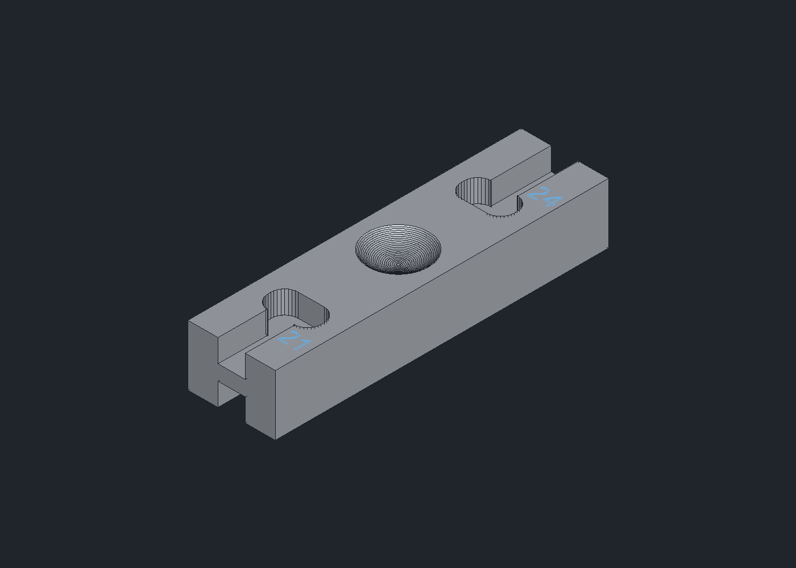
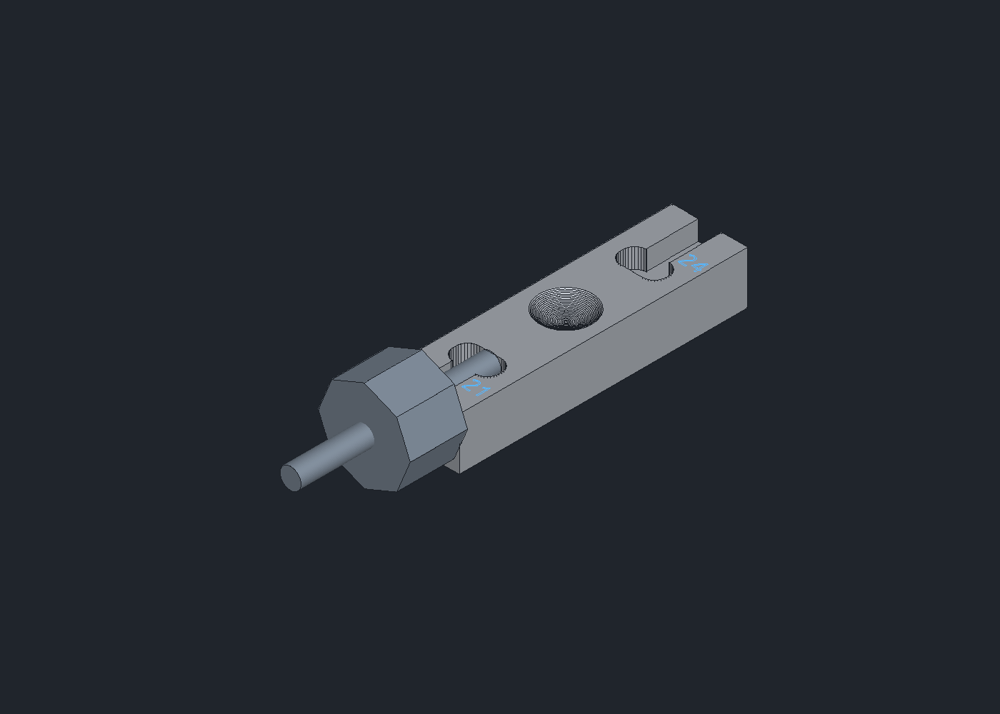
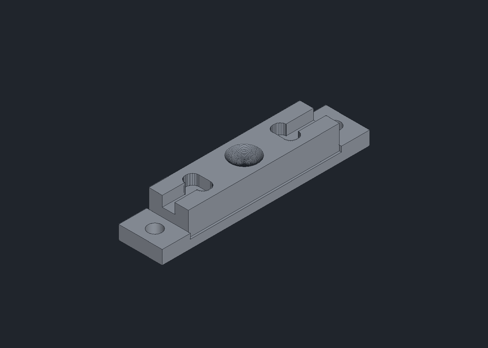
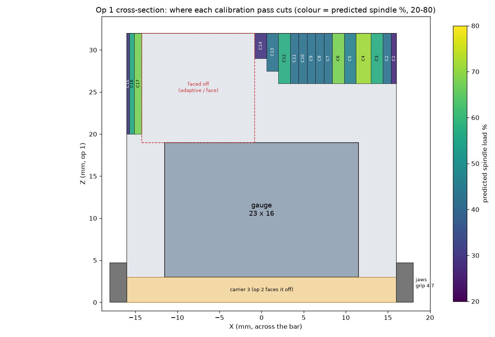

# Stick-out setting gauge: concept and plan

This is the first job under `jobs/guidelines.md`. Nothing here is CAM yet: this page is the concept, the
calibration cut plan, the op plan and the bar length, for Jonas to approve before any programs are made.

## The part

A 6061 bar, **23 × 88 × 16 mm**, with open-ended slots that run in from its end faces. **The slot's length
is the stick-out.**

To use it:
1. Push the gauge's end face up against the ER16 nut's face, with the tool loose in the collet.
2. Let the tool slide down the slot until its tip rests on the slot's end wall.
3. Tighten the nut.

The nut face and the tool tip register on two faces cut in the same setup by the same tool, so the length
is as true as the mill's X/Y. It doesn't depend on Z or on the flute length.

Why slots rather than holes: a 24 or 26 mm hole needs a tool longer than T24's 19 mm flutes. Slots measure
along the bar, and their depth is only 6 mm.

| | Slot lengths (mm) |
|---|---|
| Top face (+Y end) | **24**, **22** |
| Top face (−Y end) | **21**, 26 |
| Bottom face (+Y end) | 19, 18 |
| Bottom face (−Y end) | 20, 23 |

- The stick-outs we use are 21 (T11), 22 (T1) and 24 (T24); the others are spares.
- Slots are 6.8 wide (Ø6 and Ø6.35 tools slide in) and 6 deep, at x ±5.1. That leaves **3.0 mm outer walls**
  and a 3.4 mm web between them, with a 4 mm floor between top and bottom slots.
- The numbers are engraved 4 mm high beside each slot's inner end (the blue sketch text in the renders).
- A **Ø16 × 3.5 thumb dish** sits in the top's middle, ball-finished, so the ball rules get exercised.
- Outer edges get a 0.5 chamfer; slot, dish and engraving edges get a 0.2–0.3 edge break.

It also calibrates rcnc's stick-out check. Set a tool to 24 with the gauge, measure it on the setter, and
use **Tool change → Calibrate stick-out (24)** to give rcnc the nut face height.

## Changes after review (2026-11-17)

- **Width 20 → 23 and slots 7 → 6.8 wide, so the outer walls are 3.0 mm, not 1.5.**
  - In op 2 the jaws grip the bottom 4.7 mm of the flipped part, which at the ends is these walls.
  - Treating a wall as a cantilever off the slot floor (6 deep, 3 thick, about 40 N/mm of jaw load), it
    springs about 7 µm, against about 56 µm for the 1.5 mm wall. That's elastic, and too small to shift or
    chatter the part.
  - The wider bar leaves only 1.2 mm of side strip, so the deep side passes are now 0.3 + 0.6 on +X and 0.6
    on −X (the 0.75 pass is gone). Each side keeps 0.3 for the wall's finishing passes.
- **How the nut seats.**
  - The tool's axis is 2.8 mm below the top face (6 deep slot, 6.35 tool). An ER16 nut's face ring (about
    Ø17–28) therefore lands on the end face below and beside the tool: about 145 mm² for the standard 28 mm
    nut, about 85 mm² for a 22 mm mini nut.
  - That patch is off to one side, but it doesn't need to self-centre. The tool lies cradled in a slot
    milled square to that end face in the same setup, so the slot holds the gauge parallel to the tool. The
    end face only has to touch, and it touches flat.
  - Press the gauge straight up; don't rock it on the patch.
  - Slots deep enough to put the axis at mid-height would need about 11 mm, which leaves no floor between top
    and bottom slots.
- **Under the lugs (vise CAD, `vise.step`).** The vise is separate blocks on the table:
  - jaw blocks 48 × 95.5;
  - jaw plates 12.7 × 95.5 with the 1.9 mm ledges;
  - the 37 × 144.5 fixed-jaw centre block;
  - 61 × 140 end bases.

  Between the jaws a station is open down to the fixture plate, and the 144.5 block sits beside the station,
  not under it. So under x 0, y ±52 there is nothing for about 20 mm below the ledges, and the bores' 1 mm
  breakthrough is safe. (The STEP's parts aren't placed consistently in Z, so this comes from the part sizes
  and layout. One look at the vise confirms it.)
- **12 mm overhang each end:** fine (Jonas).

## Stock: N = 120

Bandsaw the 1" (25.4) 6061 bar to **120 mm (120–122 is fine)**.

| Region | Size | Purpose |
|---|---|---|
| Gauge | 88 long | the part |
| End lugs | 2 × 14 | locate op 2 |
| Saw allowance | 2 × 2 | |

The vise jaws are 95.5 long, so the lugs overhang them by about 12 mm at each end. The bar is held over the
middle 95.5 mm.

## Op plan

### Op 1: raw bar

The bar lies along Y in the vise (jaws at 25.4, fixed jaw left), bottom on the built-in parallels, Z0 = Vise.

| Tool | Steps |
|---|---|
| T99 | `(RCNC Z_REFERENCE Vise)`, then `FIND_STOCK SIZE=25.4,120,25.4 AT=0,0,25.4 TOL=3 DEPTH=8 KEEPZ=1`. Z comes from the Vise reference, never from the raw top. |
| T24, stick-out 24 (**Tap test** at the change) | 1. The **calibration passes A0–A2 and C1–C14** below, in the top 6.4 mm band that comes off anyway. 2. Face the rest of the band to z 19 (the gauge's top). 3. **C15–C17** in the strip outside the +X wall, 12 deep. 4. Rough the side strips and the end lugs: the lugs down to 8 thick, the walls down to z 5 (above the 4.7 jaws). 5. Rough the top slots and the dish. 6. Finish the walls with contour: leads, 1.5 mm overlap, light 0.03 last lap (PR 146). The seam goes at the middle of the −X long side, which is the back when the gauge is in use. 7. Finish the slot walls and floors. Finish the end faces y ±44 down to the lugs (z 8). 8. Helical bore the **two Ø8 through bores in the lugs** (y ±52). |
| T11 6 mm ball, stick-out 21 (**Tap test**) | 1. Dish semi-finish, then finish: scallop at **0.2 stepover (0.033 D)**. 2. A 0.2 edge break round the dish rim. |
| T1 chamfer, stick-out 22 (**Tap test**) | 1. Engrave the top numbers. 2. Chamfer 0.5 on the top outer edges. 3. Edge break 0.3 on the slot edges, tip offset about 1 mm. |

Three cutters (T24, T11, T1), within the limit of 3.

### Op 2: flipped about Y

Op 1's top goes down on the parallels. The jaws are re-set to grip the gauge's finished 23 mm walls, and the
lugs stand up at the ends.

| Tool | Steps |
|---|---|
| T99 | `(MSG, blow out the lug bores)`, then `(RCNC Z_REFERENCE Vise)`, then `FIND_BORES A=0,-52 B=0,52 D=8 TOP=19 DEPTH=3 TOL=0.1 ROT=0.2`. **Before any cutting.** The flip mirrors X; the bores are at x 0, so A and B are unchanged. |
| T24 (**Tap test**) | 1. Face the 3 mm carrier (z 19 → 16). 2. Mill the lugs and side strips off. 3. Finish the lower band of the walls and end faces with the same seam. 4. Cut the bottom slots. |
| T1 (**Tap test**) | 1. Engrave the bottom numbers. 2. Chamfer every remaining edge. |

The op 1 features stay out of reach. Locating from the carrier bores (not the part) follows the
carrier-notch rule. rcnc's **Find bores** already does it, so no new probe cycle is needed. A notch probe can
come later if you'd rather.

**To check (Jonas):**
- Nothing must be under the lugs at y ±52 (beyond the vise body), because the bores break through below z 0
  in op 1.
- 12 mm of overhang each end should be fine for a 25 × 25 bar.

## Calibration cut plan

These passes are in op 1's waste.

See [calibration.md](calibration.md) for the full table. In short:

- **Air baselines (A0–A2):** 24k, 21k and 18k, above the stock. The same path and feed as the cuts, so the
  spindle, VFD and machine's own vibration at each speed is known.
- **Width ladder at 6 deep (C1–C4):** 0.6, 1.0, 1.4 and 1.8 wide at 2400 mm/min and 24k. Predicted 27, 43,
  57 and 72%.
- **Feed ladder (C5, C3, C6):** 1.4 × 6 at 1800, 2400 and 3000 mm/min. 46, 57 and 68%.
- **rpm sweep (C7–C11):** 1.0 × 6 at 18, 19.5, 21, 22.5 and 24k, with the feed scaled so the chip stays
  the same (43% each). Only the tooth-passing frequency changes, so this is where the stability lobes and
  chatter show.
- **Repeat of C3 (C12):** shows drift and how repeatable a reading is.
- **Depth ladder (C13–C14):** 1.4 at 4.5 and 3 deep. 43 and 29%.
- **Deep side cuts (C15–C17):** 12 deep: 0.3 at 2400 (30%) and **your known 0.6 at 2500** (56%) on +X, and
  0.6 at 2400 (54%) on −X.

Nothing is predicted above 72%. Every pass is a 126 mm straight run, about 3 s of steady signal (25+
analysis windows at 48 kHz). The whole sweep is about 1 min of cutting plus the rapids.

Each pass becomes its own rCAD operation, named with its numbers, e.g. `C4 width 1.8 x 6 F2400 S24000`.
rcnc's cut log keys every line by its operation's name, so each pass maps to its pass. `import_cutlog` then
fits per operation.

**One rCAD change this needs:** per-operation spindle speed and feed (an operation `rpm`/`feed` override).
Today they come from the tool, so the rpm sweep and the feed ladder can't be separate operations of one tool.
I'll make that a small PR. The plain alternative is a Python-written calibration program, but it would lose
the simulation's chatter margin and deflection per pass, and `import_cutlog` would need its own matching.

## The transducer: what it can and can't tell

**What rcnc's `cnc-listen` records today, per program line:**
- windows heard;
- spindle speed from the tooth-passing harmonics, giving speed droop (mean and worst);
- chatter (non-harmonic peaks: how often and at what frequency);
- loudness (mean and loudest, dB).

It writes `<program>.cutlog.json` beside the program, and rCAD's `import_cutlog` fits spindle efficiency
(from droop) and the chatter scale from it.

**A vibration pickup on the head into the mic jack can measure:**
- **Spindle speed under load.** The VFD runs open-loop, so the motor slips with torque, and droop ∝ load.
  This gives the spindle power curve: efficiency and rated slip, from C1–C6 and C15–C17 against A0.
- **Chatter**, and the frequency it rings at. The C7–C11 sweep shows which speeds are quiet. This
  calibrates the chatter scale and checks the predicted tool mode (about 7.5 kHz for T24 at 24 out).
- **The tool's ring.** The tap test at each change gives each tool's mode frequency and damping.
- **Relative vibration level** per pass, which should rise with load.

**It can't measure:**
- absolute power or cutting force: it's a vibration level, not watts;
- tool deflection;
- chip packing;
- surface finish.

Calibrated against the model, though, droop stands in for power.

Measure the parts afterwards. The step widths C15–C17 and the slot lengths, measured with a micrometer or
calipers, show how far the tool bent. That checks the deflection model.

**Worth adding to rcnc** (small, before the run):
1. Save the raw audio of a calibration program as a WAV beside the program, so the analysis can be re-run
   with better methods later.
2. Log the tooth-passing amplitude per line (a load proxy, cleaner than broadband dB).
3. Name the log of an Air cut run `.air.cutlog.json`, so it doesn't overwrite the real one.

Set the input gain so C4 (72%) doesn't clip: Settings → Listening, watch the level during the air baseline.

**After the run, `analyse.py`** (to be written with the CAM) reads the cut log and the program and lists per
pass: measured droop, vibration level and chatter against predicted power, chip and chatter margin. It then
fits spindle efficiency, rated slip and the chatter scale, and says which predictions were off.
